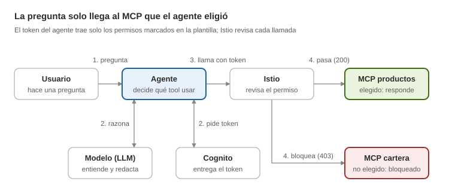

# Documentación de la PoC Agent Harness

Pregunta de la PoC: **¿sirve Kaizen como harness externo para los agentes?**

Esta carpeta reúne lo que se ha visto mientras se construye: definiciones, dudas resueltas y diagramas. Está escrita para leerse rápido.

| Archivo | Qué tiene |
|---|---|
| [definiciones.md](definiciones.md) | Qué es cada pieza, en simple |
| [preguntas-resueltas.md](preguntas-resueltas.md) | Las dudas que han salido y su respuesta |
| [reunion-2026-10-28-harness-visual.md](reunion-2026-10-28-harness-visual.md) | Resumen de la reunión que definió el alcance de la PoC |
| [diagramas/recorrido-pregunta.svg](diagramas/recorrido-pregunta.svg) | Cómo viaja una pregunta y dónde el harness bloquea |
| [diagramas/opciones-coordinacion.svg](diagramas/opciones-coordinacion.svg) | Formas de combinar agentes y MCPs |

## Dónde está cada cosa

| Qué | Dónde |
|---|---|
| Catálogo de piezas (MCPs, tools, skills, agentes, modelos) | `harness/catalogo/` |
| Plantilla "Agente con Harness" | `harness/plantilla/` |
| Caso real: agente, MCPs, identidad y despliegue | `harness/casos/atencion-cliente/` |
| Esta documentación | `harness/docs/` |

Todo vive en la rama `harness-poc`. No está unida a `main`.

## Estado

**Funciona:**
- Backstage del equipo en el EKS, con el catálogo y la plantilla cargados.
- Un agente real en el namespace `harness-poc`, que responde usando un MCP.
- Identidad del agente en Cognito, con solo los permisos que eligió.
- Istio deja pasar el MCP elegido (200) y bloquea el otro (403).
- Trazas de cada pregunta y de cada acceso.

**Falta:**
- Que la plantilla genere el agente funcional (despliegue, identidad, permisos de Istio), no solo su declaración.
- Guardar el secreto del agente en AWS Secrets Manager.
- Control por tool (MCP Gateway), aprobación humana para tools de escritura y coordinación entre agentes.

