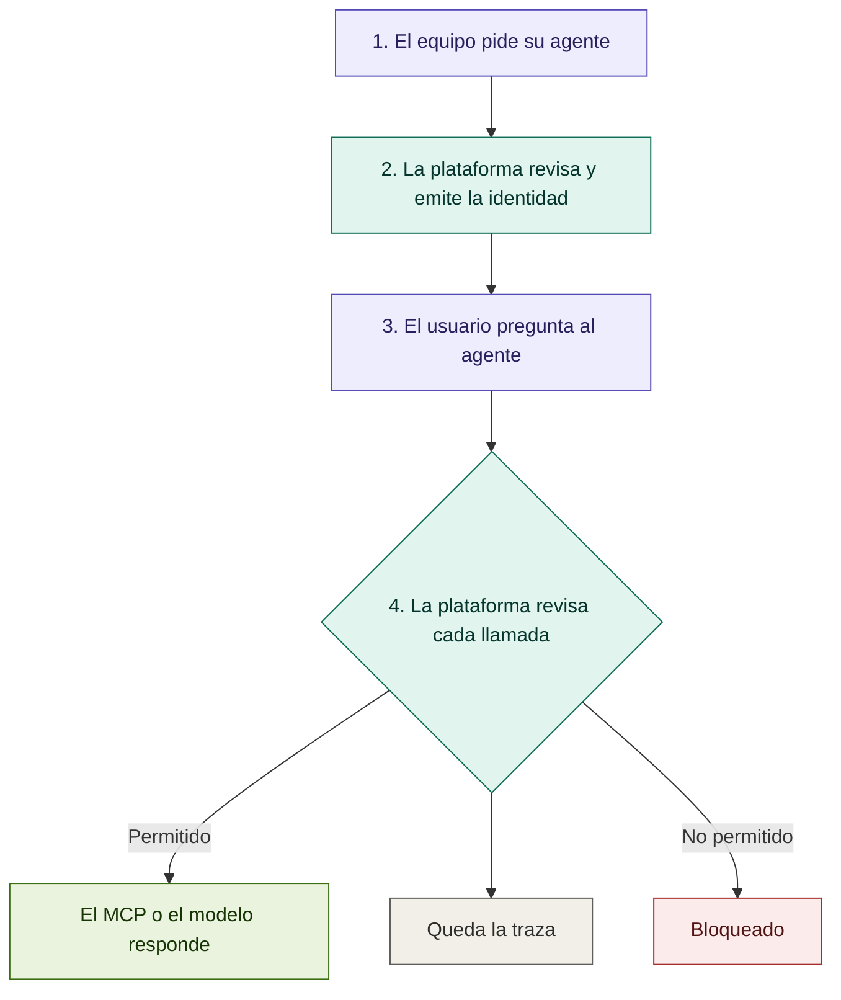

# Agent Harness: Kaizen como harness externo para agentes de IA

## Ficha de la iniciativa

| Campo | Valor |
|---|---|
| Nombre de la iniciativa | Agent Harness: Kaizen como harness externo para agentes de IA |
| Id / carpeta en repo | `agent-harness` |
| Línea de arquitectura especializada | Arquitectura Técnica de Inteligencia Artificial |
| Arquitecto Builder responsable | Diego Alejandro Diaz Parra, Andres Felipe Arango Ortiz y Jose David Mosquera Solarte |
| Estado | Borrador |
| Versión del documento | v0.1 |
| Última actualización | 2026-11-24 |

## 1. Contexto y justificación

### 1.1 Problema o necesidad

Hoy cada equipo crea sus agentes de IA y resuelve por su cuenta la identidad, los permisos, el acceso a modelos y MCPs, y las trazas. El resultado:

- Agentes con permisos amplios o inconsistentes, o que no completan su tarea por falta de accesos o contexto.
- Controles de IA fragmentados: cada agente aplica sus reglas dentro de su propio código, y su dueño puede quitarlas.

Falta una capa común de la organización, un **harness externo**, que dé a todos los agentes identidad, permisos mínimos, políticas y trazas, sin importar con qué tecnología se construyeron.

### 1.2 Por qué importa

La Arquitectura Técnica de IA busca que los agentes se construyan de forma confiable, segura y repetible. Si no se resuelve, cada nuevo agente suma accesos sin control y reglas que su dueño puede quitar. Así crece la superficie de riesgo y se vuelve difícil demostrar qué hizo cada agente ante auditoría o regulación. La oportunidad es que Kaizen ya es el portal de la organización, con catálogos, plantillas e identidades. Si sirve como harness externo, todos los agentes, pro-code y low-code, nacen con los controles comunes, sin construir una plataforma nueva.

### 1.3 Alcance

**Incluye:**

- Uso del catálogo de Kaizen para las piezas del agente: MCPs, tools, skills, agentes y modelos, sin crear un inventario paralelo.
- Plantilla "Agente con Harness" para configurar un agente de forma visual.
- Identidad del agente con permisos mínimos.
- Bloqueo en la red de los MCPs no permitidos.
- Trazas de cada pregunta y de cada acceso.

**Excluye (por ahora):**

- El harness interno de cada plataforma (ciclo de ejecución, memoria, uso de tools).
- Seguridad, gobierno y operación completos para producción.

### 1.4 Valor esperado

Si la iniciativa funciona, cada agente de Kaizen, sin importar su tecnología, opera dentro de los mismos controles: identidad propia, permisos mínimos, bloqueo en la red de lo no permitido y trazas de lo que hace. Esos controles viven en la plataforma y no en el código del agente. Kaizen pasa de ser solo el lugar donde se crean agentes a ser también el lugar donde se gobiernan durante toda su vida.

## 2. Usuarios, roles y dominio

### 2.1 Actores

| Rol | Responsabilidad en el flujo |
|---|---|
| Equipo dueño del agente | Configura su agente en Kaizen y solicita el modelo, los MCPs, las skills y los permisos que necesita |
| Plataforma Kaizen (harness externo) | Revisa la solicitud contra las reglas, emite la identidad del agente con lo permitido y hace cumplir los controles |
| Agente | Ejecuta su tarea usando solo el modelo y los MCPs permitidos. Cada llamada lleva su identidad |
| Arquitectura | Define las reglas que la plataforma hace cumplir y revisa las trazas |
| Usuario final | Conversa con el agente y recibe la respuesta |

### 2.2 Event Storming - DDD

[...]

## 3. Experiencia de usuario (agnóstica de Kaizen)

### 3.1 Flujo principal (happy path)

| Paso | Actor | Entrada | Acción | Salida / artefacto |
|---|---|---|---|---|
| 1 | Equipo dueño del agente | Modelo, MCPs, skills y permisos que necesita | Llena el formulario del agente en el portal | Solicitud del agente (manifiesto) |
| 2 | Plataforma (harness externo) | Solicitud del agente | La revisa contra las reglas | Solicitud aprobada solo con lo permitido |
| 3 | Plataforma (harness externo) | Solicitud aprobada | Emite la identidad del agente y configura el permiso de red de cada MCP | Identidad con permisos mínimos y reglas de red |
| 4 | Usuario final | Pregunta | Conversa con el agente | Pregunta recibida |
| 5 | Agente | Pregunta e identidad | Llama al modelo y al MCP permitido | Respuesta al usuario |
| 6 | Plataforma (harness externo) | Cada llamada del agente | Revisa la identidad: deja pasar lo permitido, bloquea lo demás y registra la traza | Traza y evidencia |

### 3.2 Excepciones y reglas de negocio

- **La solicitud pide algo que las reglas no permiten:** la plataforma la recorta o la rechaza, y el agente nace solo con lo permitido.
- **El agente llama a un MCP que no eligió:** la red lo bloquea y queda la traza del intento.
- **El agente llama sin identidad o con la identidad vencida:** la llamada se bloquea y el agente debe pedir una identidad nueva.
- **Falla la revisión de la solicitud:** la red sigue bloqueando lo no permitido, porque el control no depende de un solo punto.

### 3.3 Mocks / vistas esperadas (deseable, opcional)

| Vista | Propósito | Enlace / archivo |
|---|---|---|
| Formulario "Agente con Harness" | Configurar el agente y solicitar sus piezas y permisos | [...] |
| Catálogo de piezas | Ver los MCPs, tools, skills, agentes y modelos disponibles | [...] |
| Chat del agente | Conversar con el agente y ver su respuesta | [...] |

## 4. Arquitectura de la solución (agnóstica)

### 4.1 Diagrama de contexto

Debe dejar claro componentes, responsabilidades, dueños, actores, sistemas externos, límites de confianza. Archivos estáticos en la ruta `docs\Docusaurus\static\img\inicitativas-arquitectos-builder/{carpeta-iniciativa}`.

### 4.2 Datos y persistencia

[Dónde vive el estado, retención, datos sensibles, clasificación]

### 4.3 Borrador de contratos (si aplica)

**APIs:**

- [Método, recurso, payload resumido]

**Eventos / mensajería:**

- [Topic, productor, consumidor, payload clave]

**Identidades / permisos:**

- [Roles, scopes, service-to-service]

## 5. Línea base (obligatorio)

> **Requisito DoR:** sin números del "hoy" la propuesta no pasa el DoR. Captura la línea base antes del desarrollo.

| Dimensión | Cómo se hace hoy | Dato base (número) | Fuente / fecha |
|---|---|---|---|
| Tiempo | | | |
| Costo / esfuerzo | | | |
| Volumen | | | |
| Calidad / reprocesos | | | |
| Cobertura ad-hoc | | | |

## 6. Métricas de valor (después)

Debe responder a "Cómo se espera que sea el proceso". Es válido si son estimaciones.

| Dimensión | Indicador | Meta / umbral | Cómo se mide |
|---|---|---|---|
| Uso | | | |
| Adopción | | | |
| Valor | Δ vs. línea base | | |
| Adherencia | | | |

---

🚀 **Fin entregable funcional.** Los puntos a continuación se redactan para el mapeo a Kaizen. Este esquema está en construcción, así que puede haber variaciones; revisar la plantilla con frecuencia.

---

## 7. Mapeo a Kaizen

Completar solo cuando la definición agnóstica esté acordada.

| Necesidad de la solución | Habilitador / patrón Kaizen | Notas |
|---|---|---|
| [Ej. Gestión de aprobaciones] | [Ej. Approvals — ver doc de arquitectura] | [origin, ambientes, eventos] |
| | | |

### 7.1 Arquitectura con Kaizen (diagrama de despliegue)

[Dejar claro qué capacidades de la plataforma se usarán y si requiere que se habiliten nuevos casos de uso.] Debe dejar claro componentes, responsabilidades, dueños, actores, sistemas externos, límites de confianza. Archivos estáticos en la ruta `docs\Docusaurus\static\img\inicitativas-arquitectos-builder/{carpeta-iniciativa}`.

**Dependencias con otras contribuciones:** Sí (¿cuáles?) / No

## 8. Equipos, gobierno y plan

### 8.1 Equipos involucrados

| Equipo | Rol (implementa / opera / aprueba) | Compromiso |
|---|---|---|
| | | |

### 8.2 Riesgos y dependencias

| Riesgo / dependencia | Impacto | Mitigación |
|---|---|---|
| | | |

### 8.3 Plan de trabajo

| Hito | Entregable | Dependencia | Sprint / fecha |
|---|---|---|---|
| Validación funcional | Este paquete completo | | |
| Visto bueno DoR | Revisión Producto Nube | | |
| Implementación | Contribución en monorepo Kaizen | | |

Detalle adicional en `./equipos-y-plan/` si aplica.

## 10. Historial de cambios

| Versión | Fecha | Autor | Cambio |
|---|---|---|---|
| v0.1 | 2026-11-24 | Diego Alejandro Diaz Parra, Andres Felipe Arango Ortiz y Jose David Mosquera Solarte | Creación del entregable: ficha y secciones 1 a 3 |
