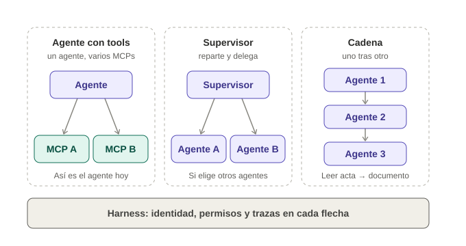

# Definiciones

Cada término con una comparación de la vida real y su papel en la PoC.

## Piezas

| Término | Qué es, en simple | En la PoC |
|---|---|---|
| **Harness (arnés)** | Lo que rodea al agente para habilitarlo y controlarlo. Como el carnet y las reglas de un empleado nuevo | Hace que el agente nazca con identidad, permisos mínimos y trazas |
| **Harness externo** | El control vive fuera del código del agente, en la plataforma | Istio, Cognito y Backstage controlan; el agente no puede saltárselo |
| **Backstage** | El portal donde se ve y se crea todo. Como el catálogo de una tienda | Muestra las piezas y tiene el formulario para crear agentes |
| **Catálogo** | El inventario de piezas registradas | Fichas de MCPs, tools, skills, agentes, modelos y bases de conocimiento |
| **Plantilla (template)** | El formulario que arma un agente nuevo | Pide nombre, piezas y permisos; crea el repo, la ficha y el blueprint |
| **Manifiesto (`harness.yaml`)** | La declaración de qué usa el agente | Modelo, MCPs con su scope, skills, otros agentes y controles |
| **Blueprint de accesos** | La lista de permisos que hay que crear | App Client, scopes y tools que piden aprobación |
| **Agente** | Programa que conversa, razona y decide qué herramienta usar | `atencion-prueba_aiagent`, hecho con LangGraph |
| **LLM (modelo)** | El "cerebro" que entiende y redacta | Un modelo dentro del clúster, en lugar del LLM Gateway corporativo |
| **LLM Gateway** | La puerta corporativa para usar modelos, con costo y control | Requiere un trámite (caso de uso, CMDB, secreto); la PoC usa un sustituto |
| **MCP** | Un servicio que le da herramientas al agente. Como un enchufe estándar | `consulta-productos_smcp` (permitido) y `cartera_smcp` (bloqueado) |
| **Tool** | Una acción concreta dentro de un MCP | `buscar_producto`, `detalle_producto` |
| **Skill** | Conocimiento o procedimiento reutilizable que se le da al agente | Fichas de ejemplo en el catálogo |
| **MCP Gateway** | Una sola puerta delante de muchos MCPs, que controla incluso qué tool se usa | Evolución esperada; hoy Istio controla por MCP completo |

## Identidad y acceso

| Término | Qué es, en simple | En la PoC |
|---|---|---|
| **Cognito** | El sistema de identidad de AWS; entrega el "carnet" (token) | User pool con un resource server `consumo-mcps` |
| **App Client** | La identidad de un agente, con nombre `<codigoApp>-<nombreApp>` | Un App Client por agente |
| **Scope** | Un permiso dentro del token, uno por MCP: `<dominio>-<nombreMcp>` | El token trae `consumo-mcps/productos-consultaProductos` |
| **Client credentials** | Forma en que una máquina pide su token, sin usuario | El agente pide y guarda en caché su token |
| **Istio** | El portero de la red del clúster | Revisa el token y deja pasar o bloquea |
| **RequestAuthentication** | Regla de Istio: "este token es válido" | Valida contra el emisor de Cognito |
| **AuthorizationPolicy** | Regla de Istio: "con este permiso puedes entrar" | Una por MCP, exige su scope |
| **Mínimo privilegio** | Cada pieza tiene solo los permisos que necesita | El agente no alcanza MCPs que no eligió |
| **IRSA** | Permiso para que un pod lea recursos de AWS sin llaves | Falta para mover el secreto a Secrets Manager |

## Plataforma

| Término | Qué es, en simple | En la PoC |
|---|---|---|
| **EKS** | El clúster de Kubernetes en AWS | Aloja Backstage, el agente, el modelo y los MCPs |
| **Namespace** | Un espacio separado dentro del clúster | `harness-poc` para el caso, `backstage-auth` para el portal |
| **ConfigMap** | Archivo de configuración que se monta en un pod | Config local de Backstage y código del agente y los MCPs |
| **Secret** | Igual que un ConfigMap, pero para datos sensibles | Token de GitHub de Backstage y credenciales del agente |
| **Trazas** | El registro de lo que hizo el agente | Cada pregunta, tool usada y acceso, en logs JSON |

## Formas de combinar piezas

| Término | Qué es |
|---|---|
| **Composición** | Combinar piezas independientes, cada una con su identidad y permisos |
| **Fusión** | Meter todo en un solo agente con un único permiso. El harness la evita |
| **Orquestación / multiagente** | Un agente coordina a otros y reparte el trabajo |
| **Supervisor** | Agente jefe que decide a qué especialista delegar |
| **Agente como herramienta** | Un agente usa a otro como si fuera una tool |
| **Cadena (pipeline)** | Agentes en fila, cada uno pasa su resultado al siguiente |
| **A2A** | Protocolo estándar para que los agentes se hablen; cada uno publica una *agent card* |
| **Agregación de MCPs** | Una sola puerta (MCP Gateway) expone las tools de muchos MCPs |

