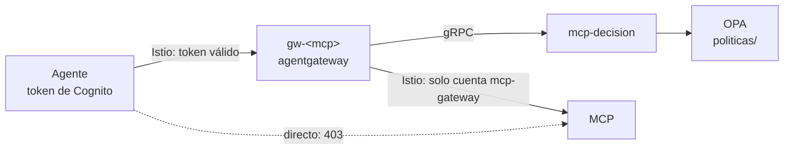

# Harness externo: bloqueos de Istio y gateway de MCPs

Las reglas viven fuera del agente. Dos filtros en serie en el namespace `harness-poc`:

| Filtro | Decide | Dónde |
|---|---|---|
| Istio | **Quién** habla con quién: todo cerrado por defecto, mTLS estricto, cada MCP solo acepta al gateway y el gateway solo acepta tokens válidos de Cognito | `00-bloqueos-istio.yaml`, `20-gateway.yaml` |
| Gateway + OPA | **Qué** puede hacer el agente en cada `tools/call`: scope del token, tool, argumentos, aprobación humana para lo que no es de lectura | `20-gateway.yaml`, `decision/`, `politicas/` |



## Piezas

- `gw-<mcp>`: un agentgateway v1.7.0 por MCP, con la cuenta de servicio `mcp-gateway`. Un solo destino por gateway, así las tools conservan su nombre.
- `mcp-decision`: servicio de decisión (Python, gRPC `ext_mcp`) con OPA al lado. Lee `client_id` y `scope` del token (Istio ya lo validó) y le pregunta a OPA. Falla cerrado.
- `politicas/`: reglas en Rego y datos (`data.json`): por MCP, su scope, sus tools de lectura y los valores de argumento prohibidos. También agentes y MCPs suspendidos.

## Resultados posibles

| Resultado | Cuándo |
|---|---|
| `allow` | Hay token, el MCP es conocido, el token trae su scope y la tool es de lectura |
| `deny` | Sin token, agente o MCP suspendido, MCP desconocido, falta el scope o un argumento prohibido (por ejemplo `kind: Secret`) |
| `approval` | La tool no está en la lista de lectura. El gateway responde con un hash; una persona aprueba con `POST /aprobar/<hash>` en el puerto 8080 de `mcp-decision` (solo por `kubectl port-forward`). La aprobación vale una vez y solo para esos argumentos |

## Desplegar y probar

```powershell
.\desplegar.ps1
```

Pruebas de las reglas (dentro del pod, no hace falta OPA local):

```powershell
kubectl exec deploy/mcp-decision -n harness-poc -c opa -- opa test /politicas/
```

Las decisiones quedan en los logs: `kubectl logs deploy/mcp-decision -n harness-poc -c decision` (línea `decision_gateway`).

## Pendiente

- `mcp-simulador` no tiene gateway todavía (sirve varios MCPs por ruta): hoy nadie puede llamarlo.
- Los scopes de los MCPs reales (`consumo-mcps/plataforma-*`) aún no existen en Cognito: hasta que la plantilla los emita, ningún agente puede usarlos.
- Salida a internet y admisión con Kyverno: fuera de este cambio.
